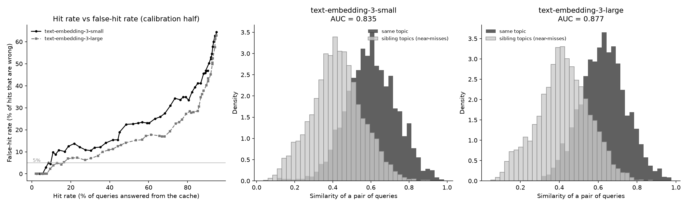

# calibcache

A semantic cache for the OpenAI client, where the settings are chosen from measured data instead of guessed.

> **Status: work in progress.** The cache, the verifier, the wrapper and the evaluation tools work. The model router and the final test run are not finished yet. All numbers below come from the *calibration half* of my data and the settings were chosen on it, so they are optimistic. Read "Limitations" before trusting any number.

## What is this?

Many apps send the same question to an LLM in different words:

- "My payment failed but the money was deducted"
- "Money got debited but the UPI transaction failed"

A semantic cache returns an old answer when a new question is similar enough. The danger is that two questions can look similar but need different answers ("failed" vs "pending"). Then the cache returns a **wrong answer**.

This project measures that danger and tries to keep it low.

## How it works

```
new question
   |
   v
embed it (text-embedding-3-large)
   |
   v
find the most similar saved question in the same group
(same model + system prompt + settings + optional user namespace)
   |
   +-- similarity >= 0.90 ..........> answer from the cache
   |
   +-- similarity 0.65 to 0.90 .....> a cheap model (gpt-5.4-mini) reads the saved
   |                                  answer and the new question and says YES or NO:
   |                                  "is the saved answer fully correct for this question?"
   |                                  YES -> answer from the cache, NO -> ask OpenAI
   |
   +-- similarity < 0.65 ...........> ask OpenAI, save the answer
```

## Quick start

```bash
git clone https://github.com/Pavangowda-dev/calibcache.git
cd calibcache
python -m venv .venv
.\.venv\Scripts\Activate.ps1          # Windows PowerShell
python -m pip install -e ".[eval]"
```

Put your key in a file called `.env` (never commit it):

```
OPENAI_API_KEY=your-key-here
```

```python
from openai import OpenAI
from calibcache import CalibClient

client = CalibClient(OpenAI())
response = client.chat.completions.create(
    model="gpt-5.4-mini",
    messages=[
        {"role": "system", "content": "You are a support assistant."},
        {"role": "user", "content": "My payment failed but money was deducted."},
    ],
    cache_namespace="user_123",   # optional: keeps one user's answers separate
)
print(response.choices[0].message.content)
print(client.last_call)           # hit or miss, similarity, cost, time
client.report()                   # hits, misses, money and time summary
```

## Related work (and what is new here)

Semantic caching and routing already exist: GPTCache (looked inactive when I checked), LiteLLM and Redis LangCache (a semantic cache with a threshold you set by hand), RouteLLM (a router), the vLLM Semantic Router, and **vCache** (ICLR 2026), which already gives a user-chosen error-rate guarantee with learned thresholds. Please check these projects yourself, because they change quickly.

So **I do not claim to be first**. This repo is a small, readable implementation with:

- an open test set where near-miss questions are built on purpose,
- a cheap verifier for the borderline zone,
- honest measurements with confidence intervals and the limits written down,
- an LLM judge that I checked against my own hand labels.

## The test data

I invented a fake UPI payments app called **PayLoom** with 41 support topics in 10 families (payment problems, limits, UPI PIN, bank accounts, merchant payments, security, wallet, fees, statements, rewards). Sibling topics look alike but have different answers on purpose (daily limit vs single-transaction limit, failed vs pending payment).

- `gpt-5.4-mini` wrote about 25 queries per topic in five styles: formal, casual, typos, Hinglish, and "minimal edit" (a sibling topic's question changed by as few words as possible).
- `gpt-5.5` then labelled every query without seeing the intended topic. Agreement was 93.6% overall, but only **58.8% for the minimal-edit near-misses**, so near-misses are noisy.
- I reviewed the 63 flagged queries by hand: 12 relabelled, 51 dropped. **Result: 940 queries** (468 calibration, 472 test).
- For the router I also made **160 hard questions** (calculation, several problems in one message, time reasoning, not covered by the policy) with reference answers. I audited 32 of them: calculation, multi-issue and timeline were 23 of 24 ok. All 8 "not covered" ones I marked wrong, and I am re-checking whether my audit rule was the problem, so that type is set aside for now.
- All data is synthetic. No real user data is used.

## Results so far (calibration half only)

**1. Plain similarity threshold vs two-band cache**
(a stream of 468 queries replayed in 20 random orders, text-embedding-3-large)

| Method | Hit rate | Wrong hits (of all hits) |
|---|---|---|
| Plain threshold (best at about 1% wrong hits, threshold 0.88) | 7.6% | 0.7% |
| Two-band cache (low 0.65, high 0.90) | 57.5% | 0.7% (worst single order 1.9%) |

A "hit" is wrong when the cached answer belongs to a different topic.

**2. Embedding models** (can the model separate same-topic pairs from sibling-topic pairs? AUC: 1.0 perfect, 0.5 coin flip)

| Model | AUC | Best hit rate at 5% wrong hits (plain threshold) |
|---|---|---|
| text-embedding-3-small | 0.835 | 9.6% |
| text-embedding-3-large | 0.877 | 15.2% |



**3. The verifier** (gpt-5.4-mini, 4,986 pairs of calibration queries with similarity of at least 0.60)

- says YES to 93.6% of same-topic pairs (2,752 of 2,940),
- says YES to 6.3% of sibling-topic pairs (99 of 1,578), the dangerous kind,
- says YES to 0 of 468 pairs from different families,
- costs about $0.00014 and 0.95 s per check.

**4. The judge** (gpt-5.5 grades an answer against the reference answer)

Checked against my own 100 hand labels: **98% agreement, Cohen's kappa 0.95** (96% and 0.91 before I fixed a flaw in two reference answers that started with "No." and "Yes,"). It wrongly accepted 1 of the 33 answers I called incorrect.

**5. Cheap vs strong model** (calibration half, 59 easy and 59 hard questions)

| | gpt-5.4-mini | gpt-5.5 |
|---|---|---|
| easy questions correct | 98.3% | 100% |
| hard questions correct | 84.7% | 94.9% |
| cost per answer | about $0.0016 | about $0.011 to $0.012 |

A *perfect* router (it cannot exist) would reach the strong model's quality (97.5%) at about $0.0025 per question instead of $0.0115. A real router will land somewhere between. The router is not built yet.

**6. Demo run** (`scripts/wrapper_demo.py`, only 11 requests): paraphrases hit, "pending vs failed" and "single transaction vs daily" near-misses were correctly answered fresh, another user or other settings never touched the cache. Average time was 1.44 s for a hit and 2.93 s for a miss. This is a demo and not a benchmark.

## What I learnt

- A near-miss can look *more* similar than a true paraphrase. In my first test "pending" scored 0.846 and the real paraphrase scored 0.840, so no single threshold can separate them.
- A plain threshold is safe only at a very low hit rate. A cheap second opinion in the middle zone changed the picture a lot.
- Generated near-miss questions are noisy. The strong model could not agree on the topic of 41% of them, so humans must check the labels.
- Reference answers can hide traps. A reference that starts with "No." is wrong for a question worded the opposite way.
- Always report the spread. The same cache gave different false-hit rates in different random orders of the same queries.

## Problems I faced

- Windows Application Control blocked `pip.exe`. Fix: use `python -m pip`.
- One damaged line (null characters) in the usage log crashed a script. Fix: the log now skips unreadable lines.
- `calibcache` was a plain folder until I added `__init__.py`, so importing the wrapper failed.
- Long runs had connection errors. Fix: every script saves its progress and can be restarted.

## Limitations

- The data is synthetic, written by LLMs, in one invented domain. Real traffic will behave differently.
- The hit rate belongs to a stream of 468 queries over 41 topics in random order. It is not a forecast for real traffic.
- The settings were chosen on the calibration half, so the numbers above are optimistic. **The test half has not been run yet.**
- The wrong-hit rate is measured on about 270 hits per run. A measured 0.7% is still consistent with a true rate of about 2 to 3%.
- The verifier was tested with the policy's reference answers as the "cached" answers. Real cached answers come from a model.
- The 928 queries the checker agreed with were not re-read by a human. Only the 63 flagged ones were.
- The judge was checked on 100 items, and only 3 were real answers that I called incorrect. Subtle partial answers are barely tested.
- The generator, checker and judge are all OpenAI models, so there may be self-preference.
- A Hinglish question often scores below the low threshold against its English twin (0.584 in the demo), so it misses the cache.
- Only single-question requests are cached (an optional system message and one user message). Streaming, tools and longer conversations go straight to OpenAI.
- Not thread-safe, brute-force search (fine for thousands of entries, not millions), no async client, OpenAI chat completions only.
- Money numbers are partly estimates until the final run measures them.

## Privacy

A cache stores what users type. This one keeps question text and answers in a local SQLite file (`calibcache.db`, ignored by git).

- Use `cache_namespace="user_123"` so one user's answers are never served to another.
- Use `ttl_seconds` to let entries expire.
- `CacheStore.delete_namespace`, `remove_expired` and `clear` delete stored data.
- Do not cache anything you should not store. The usage log keeps numbers only, never text.

## Project layout

```
calibcache/            the library
  client.py            CalibClient: drop-in wrapper around the OpenAI client
  semantic_cache.py    embeds questions, finds the closest saved one
  cache_store.py       SQLite storage (and the privacy tools)
  verifier.py          the cheap "can this saved answer be reused?" check
  judge.py             the LLM judge and its grading rules
  simulate.py          cache simulation, sweeps, confidence intervals
  policy.py, dataset.py, embed_queries.py, openai_calls.py, pricing.py,
  usage_log.py, config.py
scripts/               every experiment (generate, check, sweep, judge, ...)
data/                  PayLoom policy, queries, hard questions, answers, grades, labels
results/               charts and result tables (csv, png)
```

## Reproduce the experiments

Everything uses the OpenAI API and costs real money (a few dollars for the larger runs). Every call is logged with its cost. Run `python -c "from calibcache.usage_log import UsageLog; UsageLog().print_summary()"` to see the total.

1. `scripts/check_intents.py`: check the PayLoom policy
2. `scripts/generate_queries.py`, `check_labels.py`, `apply_review.py`: build and clean the 940 queries
3. `scripts/sweep_calibration.py`, `compare_embeddings.py`: plain-threshold results
4. `scripts/verify_pairs.py`, `sweep_two_band.py`: verifier and two-band results
5. `scripts/wrapper_demo.py`: the wrapper
6. `scripts/generate_hard_queries.py`, `apply_hard_audit.py`: hard questions
7. `scripts/collect_answers.py`, `make_judge_set.py`, `run_judge.py`: answers and judge
8. `scripts/fix_polarity.py`: a one-time fix for two policy answers

## Roadmap

- [ ] Model router: simple rules and a cheap-model check, with measured accuracy and cost
- [ ] Final run on the locked test half (hit rate, money, time, wrong hits, quality)
- [ ] A larger test set for a tighter wrong-hit claim
- [ ] The "not covered" question type
- [ ] pytest tests and packaging

## License

MIT, see `LICENSE`.